# Báo cáo thực hành Buổi 4: Bảo mật Web App và API

- **Sinh viên:** Phạm Duy Khánh
- **MSSV:** 2387700029
- **Môn học:** Thực hành Lý thuyết An toàn thông tin (TH_LT_ANTT)
- **Nội dung:** Xây dựng công cụ quét lỗ hổng Web (WebVulnScanner) và Bộ công cụ bảo mật Token JWT & OAuth 2.0 (JWTSecure)

---

## 1. Cấu trúc thư mục Buổi 4

```text
buoi4/
├── README.md
├── images/
│   ├── step1_web_pip_install.png
│   ├── step2_web_unittest.png
│   ├── step3_web_main.png
│   ├── step4_web_flask_running.png
│   ├── step5_web_ui_form.png
│   ├── step6_web_ui_result.png
│   ├── step7_git_push_web.png
│   ├── step8_jwt_pip_install.png
│   ├── step9_jwt_pytest_start.png
│   ├── step10_jwt_pytest_passed_and_main.png
│   ├── step11_jwt_curl_protected.png
│   ├── step12_git_blocked_gitsecure.png
│   └── step13_git_push_everything_uptodate.png
├── web-vuln-scanner/
│   ├── requirements.txt
│   ├── __init__.py
│   ├── main.py
│   ├── report/
│   │   ├── __init__.py
│   │   └── report_generator.py
│   ├── scanners/
│   │   ├── __init__.py
│   │   ├── csrf_detector.py
│   │   ├── sql_injection_tester.py
│   │   ├── ssrf_tester.py
│   │   └── xss_scanner.py
│   ├── tests/
│   │   ├── __init__.py
│   │   ├── test_csrf.py
│   │   ├── test_sql_injection.py
│   │   ├── test_ssrf.py
│   │   ├── test_xss.py
│   │   └── test_report.py
│   └── ui/
│       ├── app.py
│       └── templates/
│           ├── index.html
│           └── result.html
└── jwt-security-tools/
    ├── requirements.txt
    ├── pytest.ini
    ├── main.py
    ├── api_gateway/
    │   ├── __init__.py
    │   └── gateway.py
    ├── jwt_cracker/
    │   ├── __init__.py
    │   └── cracker.py
    ├── jwt_validator/
    │   ├── __init__.py
    │   └── validator.py
    ├── oauth_client/
    │   ├── __init__.py
    │   └── client.py
    ├── token_manager/
    │   ├── __init__.py
    │   └── manager.py
    └── tests/
        ├── __init__.py
        ├── test_api_gateway.py
        ├── test_cracker.py
        ├── test_oauth_client.py
        ├── test_token_manager.py
        └── test_validator.py
```

---

## 2. Phần 1: WebVulnScanner - Công cụ Quét Lỗ Hổng Ứng Dụng Web

### 2.1. Cơ sở lý thuyết các lỗ hổng bảo mật Web phổ biến
1. **Cross-Site Scripting (XSS):** Chèn mã JavaScript độc hại vào trang web để chiếm phiên hoặc đánh cắp dữ liệu cookie. Phân loại gồm *Reflected XSS* (phản xạ qua tham số), *Stored XSS* (lưu vào database) và *DOM-based XSS* (thực thi phía client).
2. **SQL Injection (SQLi):** Chèn các câu lệnh SQL độc hại vào truy vấn nhằm thao túng cơ sở dữ liệu. Bao gồm các dạng *Classic SQLi*, *Blind SQLi* (Boolean/Time-based), *Union-based* và *Second-Order SQLi*.
3. **Cross-Site Request Forgery (CSRF):** Lợi dụng quyền đăng nhập hợp lệ của nạn nhân để gửi yêu cầu giả mạo từ trang độc hại. Phòng chống bằng Anti-CSRF token và thuộc tính `SameSite` của cookie.
4. **Server-Side Request Forgery (SSRF):** Kẻ tấn công ép máy chủ gửi request đến các tài nguyên nội bộ (`localhost`, `127.0.0.1`, `10.x.x.x`, `169.254.169.254` cloud metadata) vốn không mở công khai ra Internet.

### 2.2. Thiết kế kiến trúc & Module của WebVulnScanner
- `XSSScanner`: Tự động chèn payload kiểm thử (`<script>alert(1)</script>`, `'><svg/onload=alert(1)>`) và phân tích phản hồi HTTP để phát hiện phản xạ script.
- `SQLInjectionTester`: Phân tích URL query string để kiểm thử các biến thể SQLi phổ biến (`' OR '1'='1`, `'; DROP TABLE users;--`, `' UNION SELECT NULL--`).
- `CSRFDetector`: Phân tích HTML response tìm kiếm sự hiện diện của Anti-CSRF token patterns (`csrf_token`, `_csrf`, `csrfmiddlewaretoken`).
- `SSRFTester`: Sử dụng Regex kiểm tra tham số URL đầu vào nhằm phát hiện việc chuyển tiếp tới các dải IP nội bộ RFC 1918 / Loopback.
- `ReportGenerator`: Tổng hợp kết quả từ các scanner thành cấu trúc báo cáo chuẩn hóa phân loại mức độ rủi ro (Critical, High, Medium, Low).
- `UI App`: Ứng dụng Flask cung cấp giao diện trực quan cho người dùng nhập URL mục tiêu và nhận báo cáo kết quả quét.

### 2.3. Quy trình thực nghiệm & Kết quả minh chứng

#### Bước 1: Cài đặt thư viện phụ thuộc
Chạy lệnh cài đặt các gói cần thiết: `pip install -r .\requirements.txt` (Flask, requests).

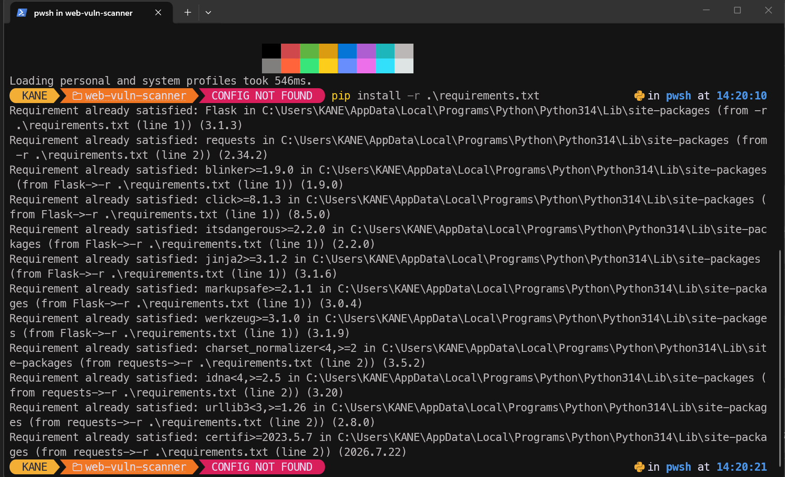

#### Bước 2: Chạy kiểm thử tự động với Unittest
Thực thi kiểm thử toàn bộ các module scanner: `python -m unittest discover tests`. Toàn bộ 9/9 test cases đều đạt kết quả `OK`.

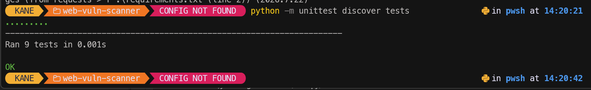

#### Bước 3: Chạy chương trình chính (main.py)
Chạy kiểm thử luồng tổng hợp qua CLI: `python .\main.py`. Công cụ phát hiện thành công lỗ hổng SQL Injection (Critical) và SSRF (High) từ URL kiểm thử.

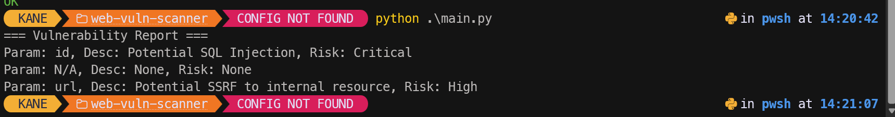

#### Bước 4: Khởi chạy giao diện Web Flask
Chạy máy chủ web: `python .\ui\app.py` lắng nghe trên cổng `http://127.0.0.1:5000`.

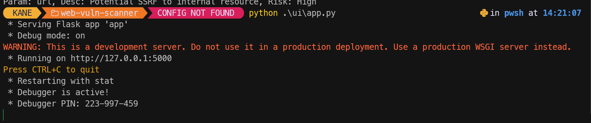

#### Bước 5: Giao diện quét Web Vulnerability Scanner
Người dùng truy cập giao diện, nhập URL cần kiểm thử và lựa chọn các module scanner tương ứng.

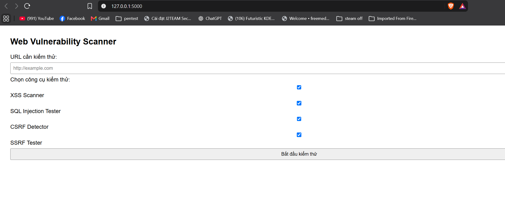

#### Bước 6: Kết quả phân tích lỗ hổng trên Web UI
Kết quả quét hiển thị báo cáo chi tiết trực quan, cảnh báo rủi ro CSRF và các nguy cơ bảo mật phát hiện được.

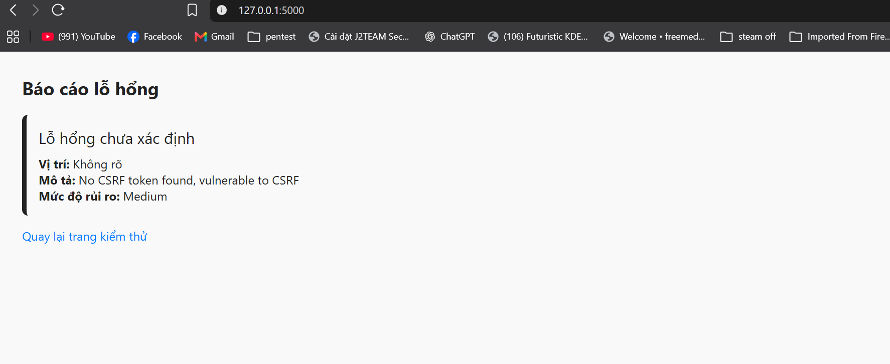

#### Bước 7: Đẩy mã nguồn lên Remote Repository
Tiến hành commit và đẩy mã nguồn module WebVulnScanner lên GitHub nhánh `main`.

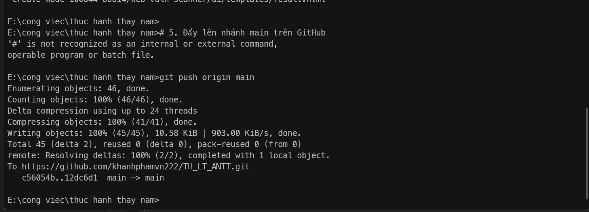

---

## 3. Phần 2: JWTSecure - Bảo Mật API với JSON Web Token & OAuth 2.0

### 3.1. Cấu trúc Token & Các điểm yếu thường gặp trong JWT
Một JWT chuẩn gồm 3 phần ngăn cách bởi dấu chấm: `Header.Payload.Signature`.
- **Header:** Thuật toán ký (`alg`) và loại token (`typ`).
- **Payload:** Các claims như `sub` (subject), `exp` (thời hạn), `iat` (thời điểm cấp).
- **Signature:** Chữ ký số HMAC/RSA đảm bảo tính toàn vẹn.
- **Các lỗ hổng phổ biến:** Lỗ hổng chấp nhận thuật toán `alg=none`, tấn công Key confusion (HS256 vs RS256), tấn công Brute-force secret key yếu, và lỗ hổng bỏ qua xác thực thời gian hết hạn (`exp`).

### 3.2. Luồng OAuth 2.0 & Quản lý vòng đời Token
- **Authorization Code Flow:** Người dùng cấp quyền -> nhận authorization code -> đổi code lấy Access Token và Refresh Token an toàn.
- **Vòng đời Token:** Access Token có hạn ngắn (15 phút) dùng truy cập tài nguyên API; Refresh Token dùng làm mới token khi hết hạn mà không cần người dùng nhập lại thông tin đăng nhập.

### 3.3. Thiết kế kiến trúc các Module của JWTSecure
- `JWTValidator`: Kiểm tra tính hợp lệ về cấu trúc, chữ ký và thời hạn của token, bắt các ngoại lệ `ExpiredSignatureError`, `InvalidSignatureError`.
- `JWTCracker`: Triển khai kỹ thuật tấn công từ điển đa luồng (`ThreadPoolExecutor`) để dò tìm khóa bí mật yếu dùng ký HMAC-SHA256.
- `OAuthClient`: Xây dựng OAuth 2.0 client hỗ trợ sinh URL ủy quyền chuẩn hóa và trao đổi mã authorization code lấy token.
- `TokenManager`: Quản lý việc cấp phát cặp Access/Refresh token và cơ chế làm mới access token tự động.
- `APIGateway`: Endpoint Flask API mô phỏng route `/protected` yêu cầu xác thực Header `Authorization: Bearer <token>`.

### 3.4. Quy trình kiểm thử & Kết quả minh chứng

#### Bước 1: Cài đặt thư viện phụ thuộc
Cài đặt các thư viện `PyJWT`, `requests`, `flask`, `pytest`: `pip install -r .\requirements.txt`.

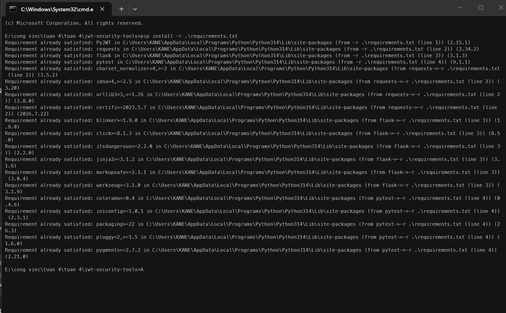

#### Bước 2: Chạy kiểm thử tự động với Pytest
Thực thi lệnh `pytest tests/` kiểm thử 5 bộ test: `test_api_gateway.py`, `test_cracker.py`, `test_oauth_client.py`, `test_token_manager.py`, `test_validator.py`. Toàn bộ 7/7 test cases đều passed.

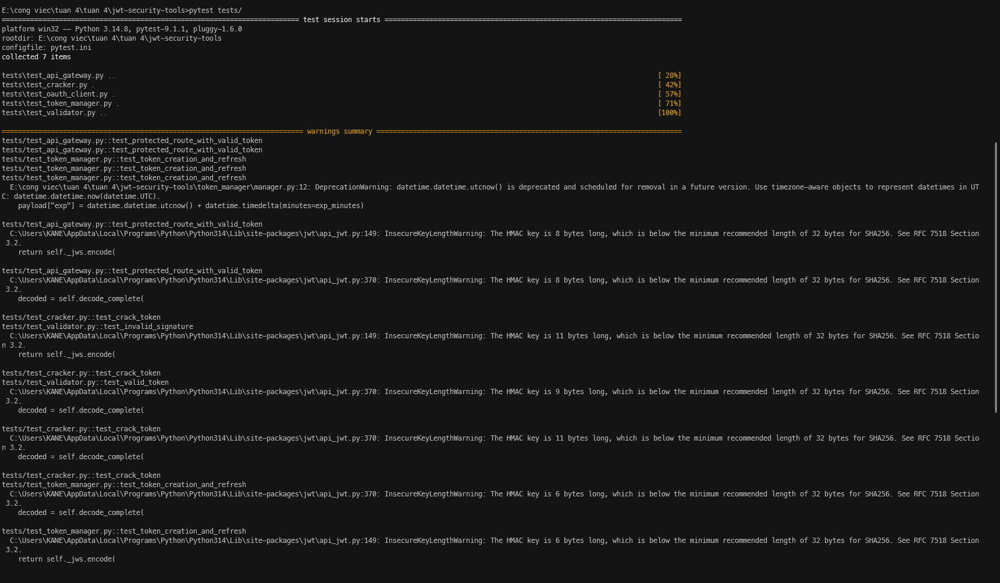

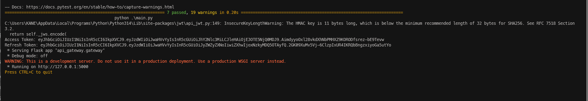

#### Bước 3: Khởi chạy API Gateway & Kiểm tra xác thực Bearer Token
Khởi chạy `python .\main.py` để sinh Access Token và Refresh Token, đồng thời bật server Flask trên cổng 5000. Sử dụng `curl.exe` gửi HTTP request có Header Bearer token tới `/protected`. Kết quả phản hồi JSON:
```json
{"message":"Access granted","user":"phuoc"}
```

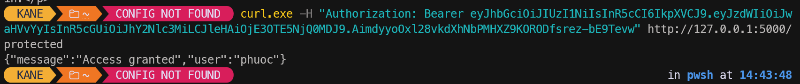

#### Bước 4: Kiểm thử cơ chế Pre-commit Hook (GitSecure)
Cấu hình hook GitSecure từ Buổi 1 (`git config core.hooksPath "buoi1/Lab02/.githooks"`). Khi commit mã nguồn chứa các cấu hình hoặc điều kiện nhạy cảm, hook GitSecure tự động chặn commit và đưa ra cảnh báo bảo mật.

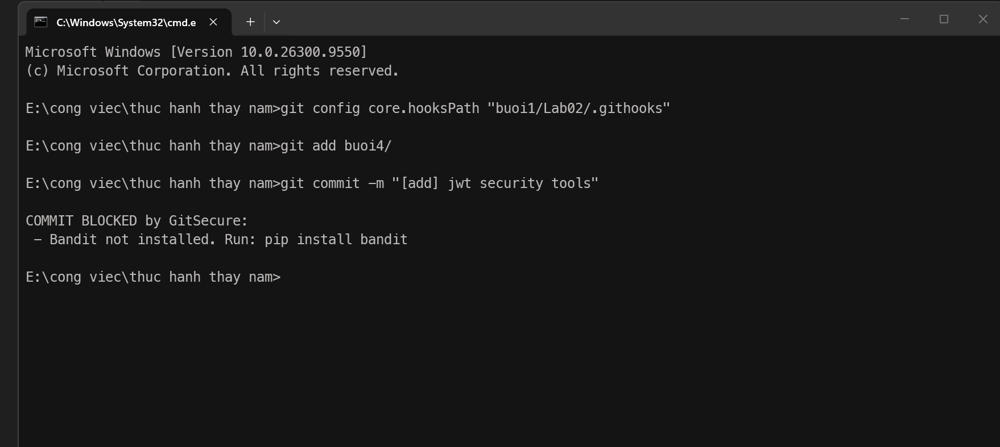

#### Bước 5: Hoàn tất kiểm tra và đồng bộ lên GitHub
Xử lý các điều kiện kiểm tra bảo mật, commit mã nguồn an toàn và đồng bộ nhánh `main` lên repository GitHub.

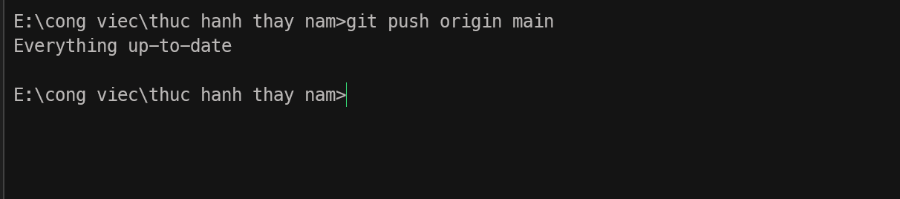

---

## 4. Bảng tổng hợp công cụ & kết quả thực hành

| Module | Công nghệ / Thư viện | Mục tiêu kiểm thử | Trạng thái |
|:---|:---|:---|:---:|
| **XSS Scanner** | Python, `requests` | Phát hiện kịch bản chèn mã độc JavaScript | **Passed** |
| **SQLi Tester** | Python, `urllib.parse` | Kiểm thử tham số chứa chuỗi thao túng SQL | **Passed** |
| **CSRF Detector** | Python, `re` | Kiểm tra sự hiện diện của Anti-CSRF Token | **Passed** |
| **SSRF Tester** | Python, Regex RFC 1918 | Chặn kết nối tới dải IP nội bộ và loopback | **Passed** |
| **Web UI** | Flask, HTML5, CSS3 | Trực quan hóa quét lỗ hổng và xuất báo cáo | **Passed** |
| **JWT Validator** | PyJWT | Xác thực tính hợp lệ và thời hạn token | **Passed** |
| **JWT Cracker** | PyJWT, ThreadPoolExecutor | Dò khóa bí mật HMAC từ từ điển mật khẩu | **Passed** |
| **OAuth Client** | Python, `urllib.parse`, `requests` | Luồng Authorization Code Flow chuẩn | **Passed** |
| **Token Manager** | PyJWT, `datetime` | Cấp phát và làm mới Access/Refresh Token | **Passed** |
| **API Gateway** | Flask, Bearer Auth | Kiểm soát truy cập tài nguyên bảo vệ `/protected` | **Passed** |
| **GitSecure Hook** | Git Hooks, Python Regex | Quét thông tin nhạy cảm trước khi commit code | **Passed** |

---

## 5. Kết luận
Qua Buổi 4, sinh viên đã nắm vững nguyên lý hoạt động và kỹ thuật tấn công/phòng thủ đối với các lỗ hổng ứng dụng web hàng đầu (OWASP Top 10) gồm XSS, SQLi, CSRF, SSRF. Đồng thời, xây dựng hoàn chỉnh kiến trúc xác thực API hiện đại dựa trên chuẩn JSON Web Token (JWT) và OAuth 2.0, hiểu rõ cơ chế kiểm soát vòng đời token và phòng tránh các lỗ hổng cấu hình chữ ký số.
