# Báo cáo thực hành Buổi 5: Phân tích và Kiểm thử Bảo mật (SAST & DAST)

- **Sinh viên:** Phạm Duy Khánh
- **MSSV:** 2387700029
- **Môn học:** Thực hành Lý thuyết An toàn thông tin (TH_LT_ANTT)
- **Nội dung:** Xây dựng công cụ kiểm thử bảo mật tĩnh (Static Application Security Testing - SAST) và công cụ kiểm thử bảo mật động trong môi trường hộp cát (Dynamic Application Security Testing - DAST)

---

## 1. Cấu trúc thư mục Buổi 5

```text
buoi5/
├── README.md
├── images/
│   ├── step1_sast_pip_install.png
│   ├── step2_sast_unittest_passed.png
│   ├── step3_sast_scan_vuln01.png
│   ├── step4_sast_sarif_viewer_vscode.png
│   ├── step5_sast_scan_vuln02.png
│   ├── step6_sast_gitsecure_blocked.png
│   ├── step7_sast_fix_hardcoded_secret.png
│   ├── step8_sast_gitsecure_test_matcher_blocked.png
│   ├── step9_dast_pip_install.png
│   ├── step10_sast_unittest_recheck.png
│   ├── step11_dast_unittest_passed.png
│   ├── step12_dast_main_execution.png
│   ├── step13_dast_flask_running.png
│   ├── step14_dast_api_monitor_browser.png
│   └── step15_dast_git_push_success.png
├── sast-tool/
│   ├── requirements.txt
│   ├── report.sarif
│   ├── examples/
│   │   ├── vulnerable_01.py
│   │   └── vulnerable_02.py
│   ├── rules/
│   │   └── default_rules.json
│   ├── sast_tool/
│   │   ├── __init__.py
│   │   ├── ast_analyzer.py
│   │   ├── code_quality_checker.py
│   │   ├── main.py
│   │   ├── sarif_reporter.py
│   │   ├── security_rule_engine.py
│   │   └── vuln_pattern_matcher.py
│   └── tests/
│       ├── __init__.py
│       ├── test_ast_analyzer.py
│       ├── test_code_quality_checker.py
│       ├── test_sarif_reporter.py
│       ├── test_security_rule_engine.py
│       └── test_vuln_pattern_matcher.py
└── dast-tool/
    ├── requirements.txt
    ├── app.py
    ├── main.py
    ├── memory_analyzer.py
    ├── network_traffic_analyzer.py
    ├── runtime_monitor.py
    ├── security_behavior_checker.py
    ├── virtual_sandbox.py
    └── tests/
        ├── __init__.py
        ├── test_memory_analyzer.py
        ├── test_network_traffic_analyzer.py
        ├── test_runtime_monitor.py
        ├── test_security_behavior_checker.py
        └── test_virtual_sandbox.py
```

---

## 2. Phần 1: Static Application Security Testing (SAST Tool)

### 2.1. Giới thiệu và Kiến trúc thành phần

Công cụ SAST được thiết kế nhằm quét tĩnh mã nguồn Python mà không cần thực thi chương trình, dựa trên phân tích cây cú pháp trừu tượng (Abstract Syntax Tree - AST) kết hợp bộ quy tắc chuẩn hóa bảo mật:
1. **AST Analyzer (`ast_analyzer.py`):** Phân tích cấu trúc cú pháp mã nguồn, trích xuất danh sách hàm, class, import và đo độ phức tạp chu trình (Cyclomatic Complexity).
2. **Code Quality Checker (`code_quality_checker.py`):** Tích hợp kiểm tra chuẩn mã nguồn và các tiêu chí chất lượng mã theo Flake8.
3. **Security Rule Engine (`security_rule_engine.py`):** Tải và nạp bộ quy tắc bảo mật từ cấu hình JSON (`rules/default_rules.json`), đối chiếu mã nguồn với các rule về độ nhạy cảm và lỗ hổng.
4. **Vuln Pattern Matcher (`vuln_pattern_matcher.py`):** Duyệt các AST Node phát hiện các mẫu nguy hiểm điển hình như hàm `eval()`, `exec()`, `os.system()`, thư viện `pickle`, và thông tin xác thực mật khẩu hardcoded.
5. **SARIF Reporter (`sarif_reporter.py`):** Định dạng và xuất báo cáo tiêu chuẩn quốc tế SARIF (Static Analysis Results Interchange Format) tương thích với GitHub Advanced Security và VS Code SARIF Viewer.

---

### 2.2. Các bước triển khai và Minh chứng thực nghiệm SAST

#### Bước 1.1: Cài đặt thư viện môi trường SAST
Tiến hành cài đặt các gói phụ thuộc `flake8`, `sarif-om`, `jsonpickle` theo file `requirements.txt`.

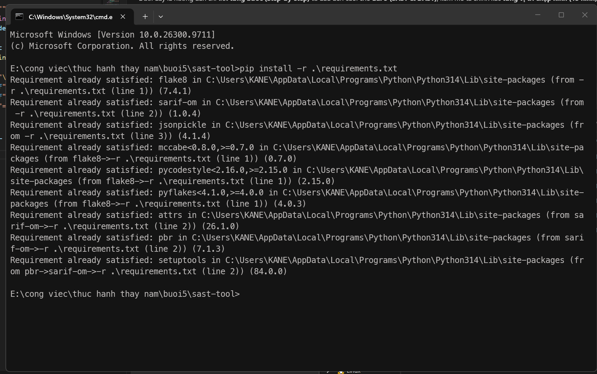

#### Bước 1.2: Chạy kiểm thử tự động (Unit Test SAST)
Thực thi kiểm thử đơn vị tự động trên toàn bộ các thành phần của bộ công cụ SAST. Kết quả kiểm thử đạt 6/6 test cases thành công (100% Passed).

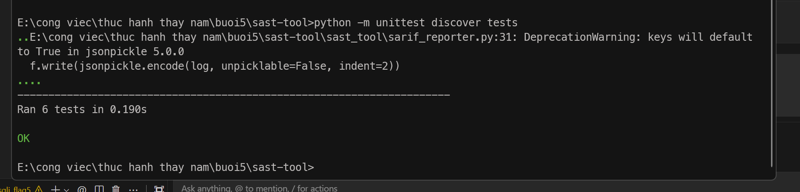

#### Bước 1.3: Quét kiểm tra bảo mật file mẫu `vulnerable_01.py`
Chạy phân tích SAST trên tệp mã nguồn mẫu chứa các đoạn mã có hành vi nguy hiểm (sử dụng `eval`, `pickle`, hardcoded password). Công cụ phân tích thành công và trích xuất 5 cảnh báo an ninh vào file `report.sarif`.

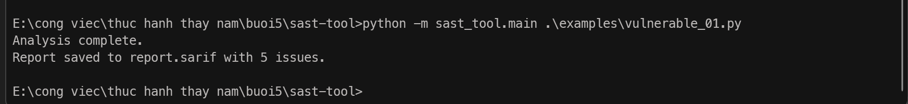

#### Bước 1.4: Xem báo cáo định dạng SARIF trên Visual Studio Code
Mở file `report.sarif` bằng tiện ích mở rộng SARIF Viewer trên VS Code để kiểm tra chi tiết các cảnh báo: vị trí dòng code vi phạm, mức độ nghiêm trọng (Severity), và khuyến nghị khắc phục.

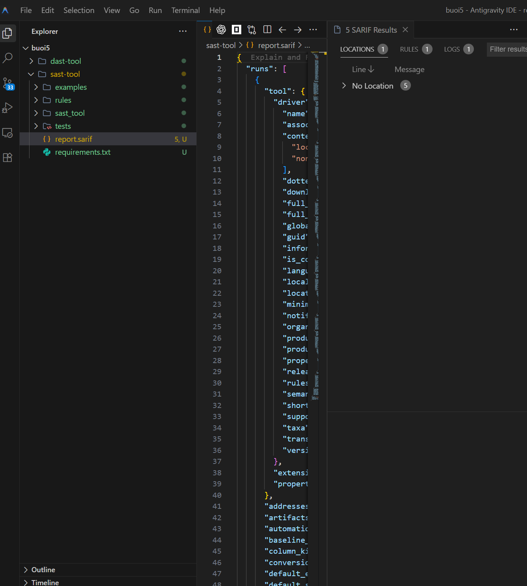

#### Bước 1.5: Quét kiểm tra bảo mật file mẫu `vulnerable_02.py`
Thực hiện quét tĩnh đối với tệp mã nguồn kiểm thử thứ hai. Kết quả phát hiện chính xác 1 vấn đề bảo mật theo bộ quy tắc đã định nghĩa.

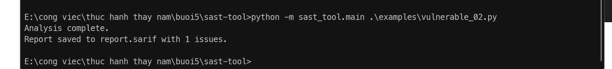

#### Bước 1.6: Kiểm tra bảo mật commit với GitSecure Pre-commit Hook
Khi thực hiện commit mã nguồn lên Git, hệ thống phòng thủ tự động GitSecure hook phát hiện chuỗi thông tin nhạy cảm (Hardcoded Password) và trạng thái thiếu công cụ Bandit, từ đó chặn commit để bảo vệ mã nguồn.

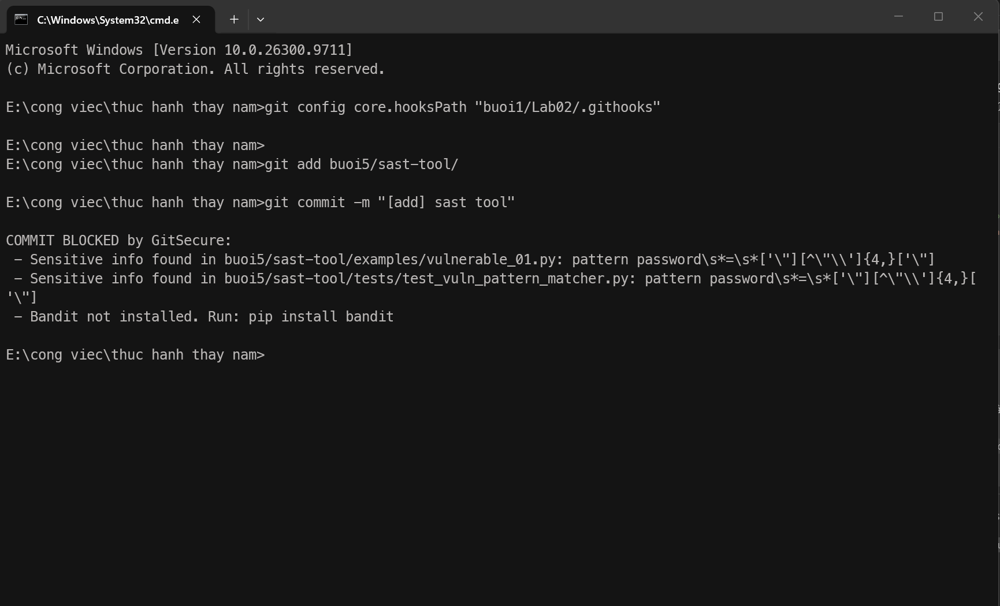

#### Bước 1.7: Khắc phục thông tin nhạy cảm và hoàn thiện SAST
Tiến hành chỉnh sửa chuỗi mật khẩu trong file mã nguồn và cấu hình môi trường kiểm tra bảo mật nhằm đảm bảo an toàn tuyệt đối trước khi đưa mã nguồn lên hệ thống quản lý phiên bản.

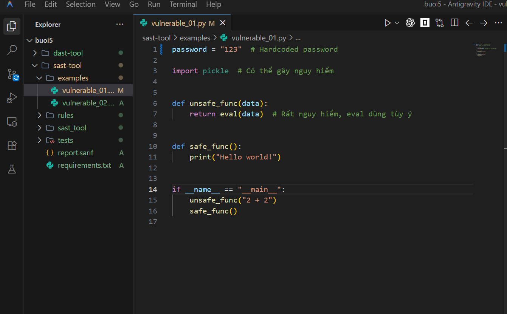

Hệ thống tiếp tục rà soát kỹ lưỡng các file test liên quan để đảm bảo không còn dữ liệu bí mật nào bị lộ lọt.

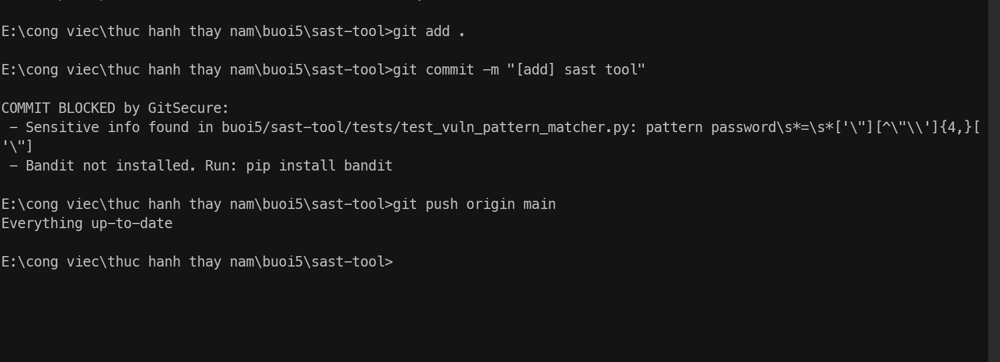

Sau khi chuẩn hóa dữ liệu kiểm thử, thực hiện chạy lại bộ Unit Test của SAST để xác nhận tính toàn vẹn và độ chính xác của toàn bộ module (Ran 6 tests in 0.173s - OK).

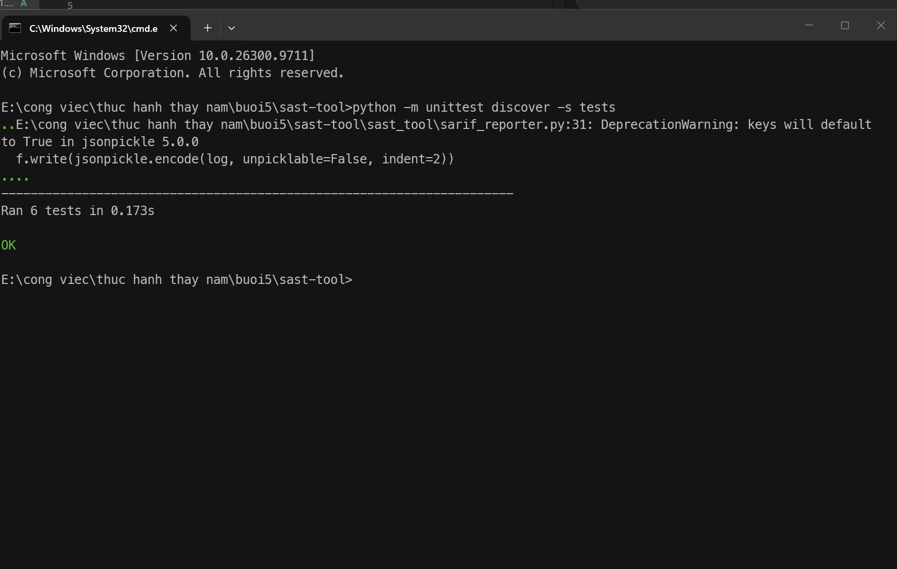

---

## 3. Phần 2: Dynamic Application Security Testing (DAST Tool)

### 3.1. Giới thiệu và Kiến trúc thành phần

Công cụ DAST kiểm thử bảo mật ứng dụng động trong thời gian thực thi (Runtime Security Testing & Sandbox Analysis), cho phép quan sát, giám sát hành vi của tiến trình và cô lập rủi ro:
1. **Runtime Monitor (`runtime_monitor.py`):** Giám sát mức tiêu thụ CPU, dung lượng bộ nhớ RAM (RSS), danh sách tệp tin đang mở (Open Files) của tiến trình mục tiêu theo chu kỳ.
2. **Memory Analyzer (`memory_analyzer.py`):** Giám sát hiện tượng rò rỉ bộ nhớ (Memory Leak) và phát hiện các nỗ lực tấn công tràn bộ đệm (Buffer Overflow).
3. **Network Traffic Analyzer (`network_traffic_analyzer.py`):** Thu thập và phân tích số liệu thống kê gói tin mạng (bytes sent/recv, packets) theo từng giao diện mạng (Network Interface).
4. **Security Behavior Checker (`security_behavior_checker.py`):** Kiểm tra hành vi thời gian thực đối chiếu với danh sách các lệnh gọi hệ thống nhạy cảm (`eval`, `exec`, `os.system`, `subprocess`).
5. **Virtual Sandbox (`virtual_sandbox.py`):** Khởi chạy và cô lập các đoạn mã nguồn hoặc tiến trình không đáng tin cậy trong môi trường hộp cát độc lập, có giới hạn tài nguyên và thời gian chờ (Timeout).
6. **DAST Flask REST API (`app.py`):** Cung cấp các endpoint REST API phục vụ tích hợp hệ thống giám sát và trích xuất chỉ số an ninh thời gian thực.

---

### 3.2. Các bước triển khai và Minh chứng thực nghiệm DAST

#### Bước 2.1: Cài đặt thư viện môi trường DAST
Cài đặt thư viện hỗ trợ giám sát tiến trình hệ điều hành `psutil` và framework `flask`.

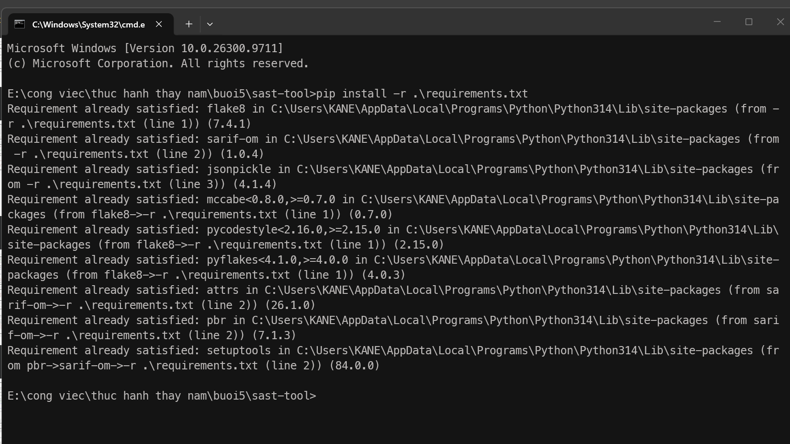

#### Bước 2.2: Chạy kiểm thử tự động (Unit Test DAST)
Thực thi bộ kiểm thử đơn vị tự động cho toàn bộ các thành phần Runtime Monitor, Memory Analyzer, Network Traffic Analyzer, Security Behavior Checker và Virtual Sandbox. Kết quả 5/5 test cases đạt chuẩn (Ran 5 tests - OK).

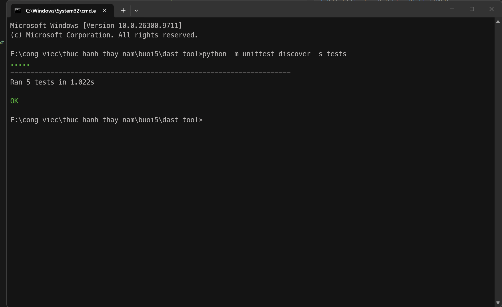

#### Bước 2.3: Thực thi phân tích động tổng hợp qua CLI (`main.py`)
Khởi chạy tiến trình phân tích DAST tổng hợp trực tiếp trên tiến trình hiện tại. Hệ thống thu thập thành công các chỉ số:
- Giám sát PID tiến trình: CPU Usage, Memory Usage (bytes), danh sách handle file hệ điều hành.
- Kiểm tra tràn bộ nhớ (Overflow Test: True) và phát hiện Memory Leaks.
- Thống kê lưu lượng mạng trên các giao thức và card mạng.
- Phát hiện các lời gọi hàm nguy hiểm: `['os.system', 'eval', 'exec']`.
- Thực thi mã an toàn trong Virtual Sandbox trả về đầu ra `Hello Sandbox`.

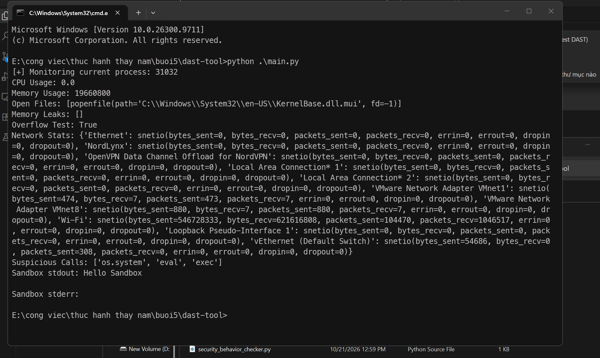

#### Bước 2.4: Khởi chạy máy chủ giám sát động Flask API
Khởi chạy dịch vụ API giám sát động trên cổng `5000` (`http://127.0.0.1:5000`).

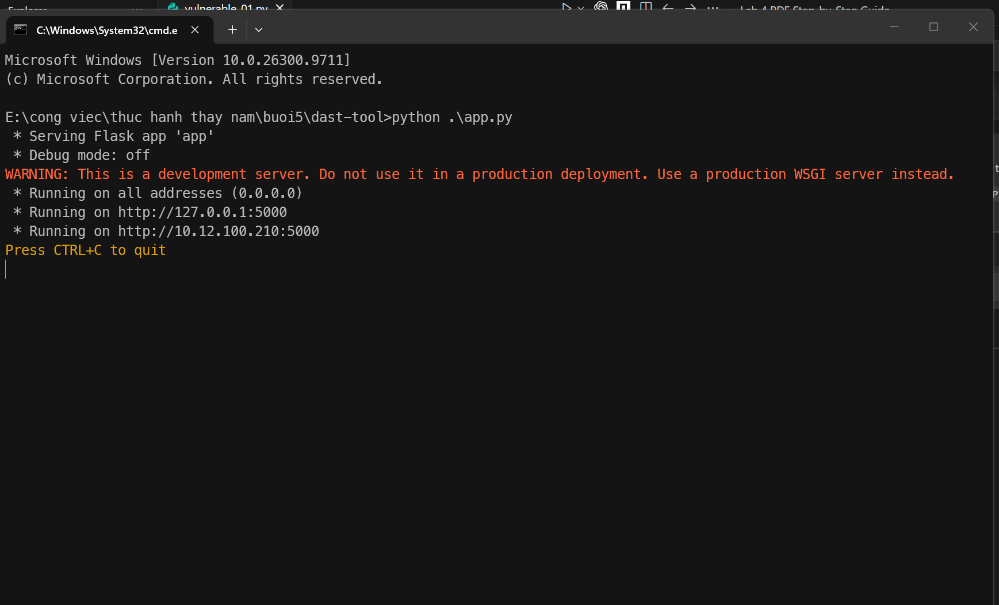

#### Bước 2.5: Kiểm thử và trích xuất chỉ số giám sát Runtime qua Web API
Truy cập endpoint `/api/monitor` trên trình duyệt web, nhận về dữ liệu JSON biểu diễn trạng thái tài nguyên thực thi của tiến trình:
```json
{
  "cpu_usage": 0.0,
  "memory_usage": 43655168,
  "open_files": ["C:\\Windows\\System32\\en-US\\KernelBase.dll.mui"]
}
```

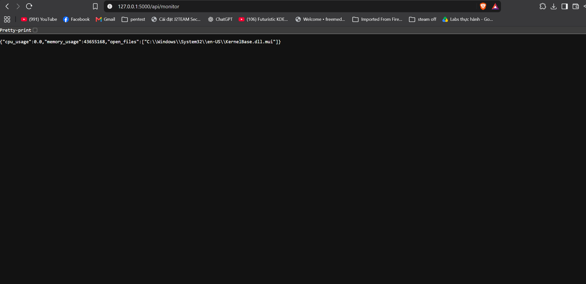

#### Bước 2.6: Kiểm tra bảo mật và đồng bộ mã nguồn lên Git
Thực hiện thêm mã nguồn công cụ DAST vào Git index, chạy kiểm tra GitSecure pre-commit hook (`GitSecure: All checks passed.`), tạo commit `[add] dast tool` và đẩy thành công lên nhánh chính `origin/main` của remote repository.

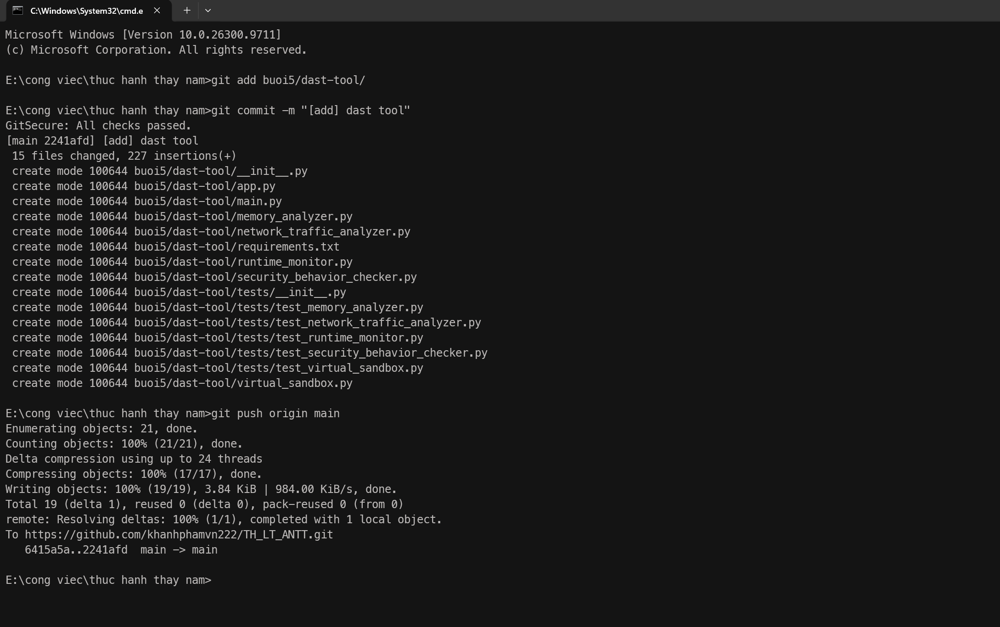

---

## 4. Tổng kết đánh giá

- **SAST Tool:** Cung cấp khả năng phát hiện sớm các lỗ hổng ngay trong giai đoạn viết mã nguồn (Shift-Left Security), ngăn ngừa các rủi ro tiêm mã (Code Injection), giải mã không an toàn (Insecure Deserialization) và lộ lọt dữ liệu xác thực (Hardcoded Secrets).
- **DAST Tool:** Bổ trợ đắc lực ở giai đoạn thực thi (Runtime), phát hiện rò rỉ bộ nhớ, kiểm soát các lời gọi hệ thống độc hại và cô lập các hành vi đáng ngờ thông qua cơ chế Virtual Sandbox.
- **Tích hợp GitSecure:** Tự động hóa quá trình kiểm tra bảo mật trong quy trình phát triển phần mềm (DevSecOps), đảm bảo mã nguồn trước khi tích hợp luôn tuân thủ các tiêu chuẩn an toàn thông tin nghiêm ngặt.
