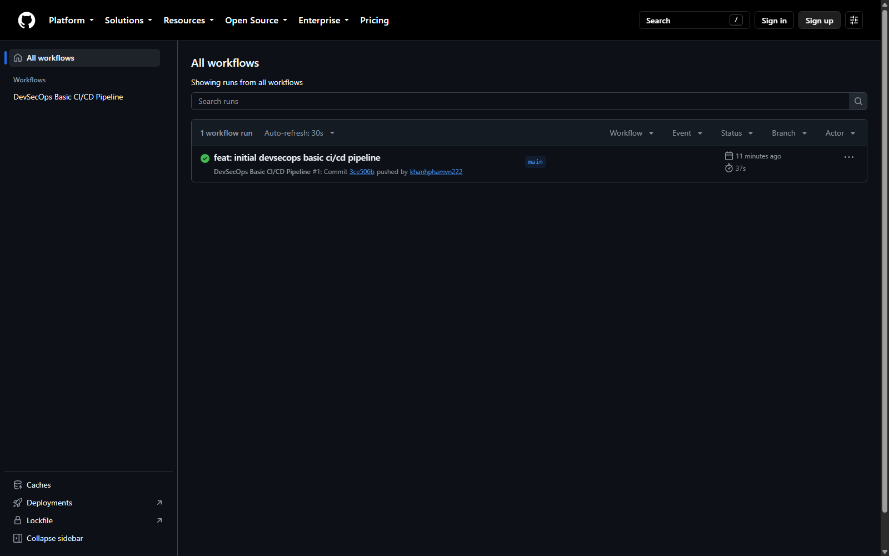
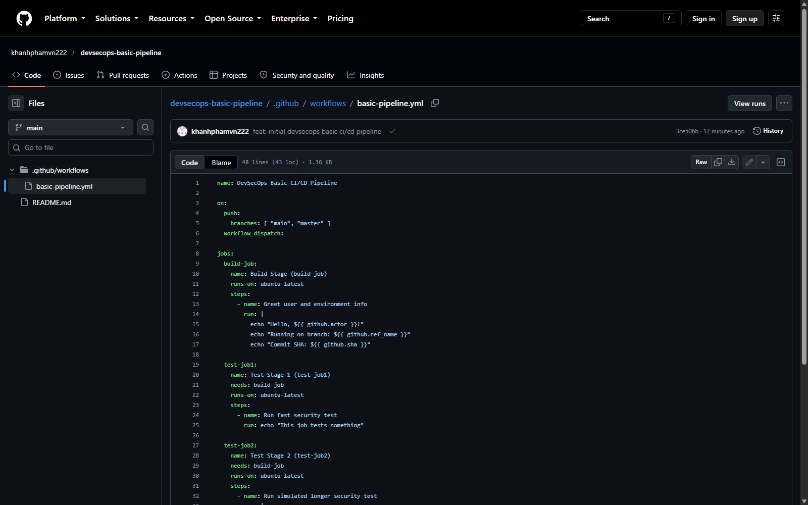
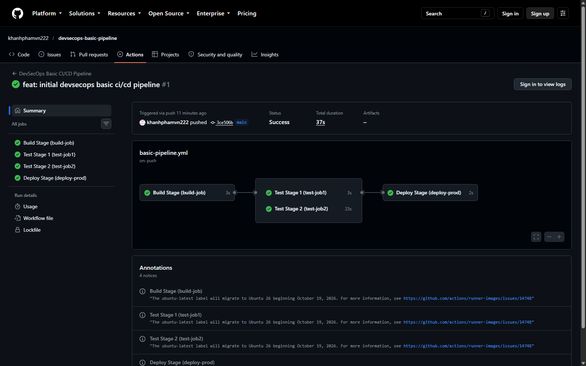
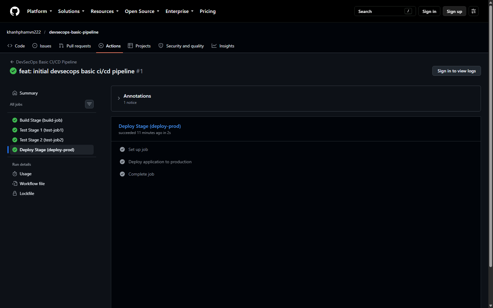
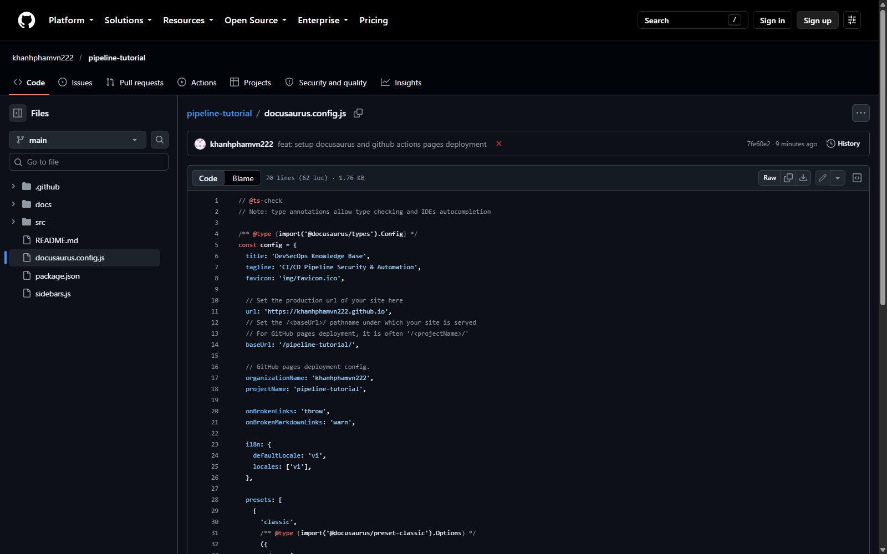
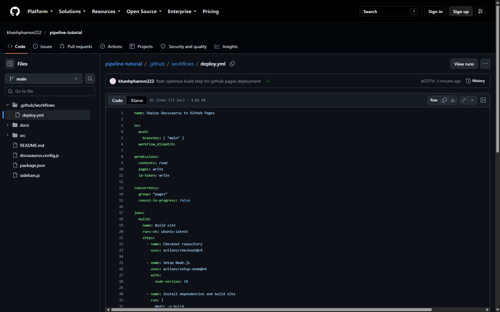
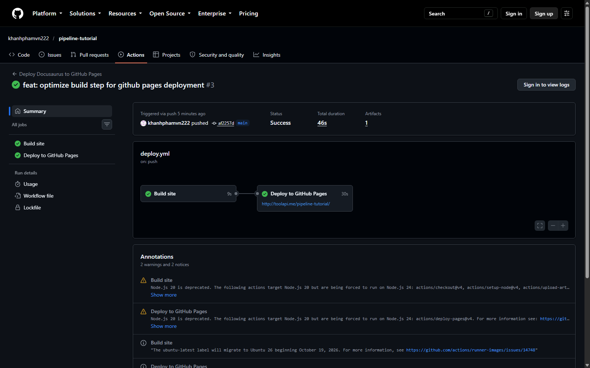
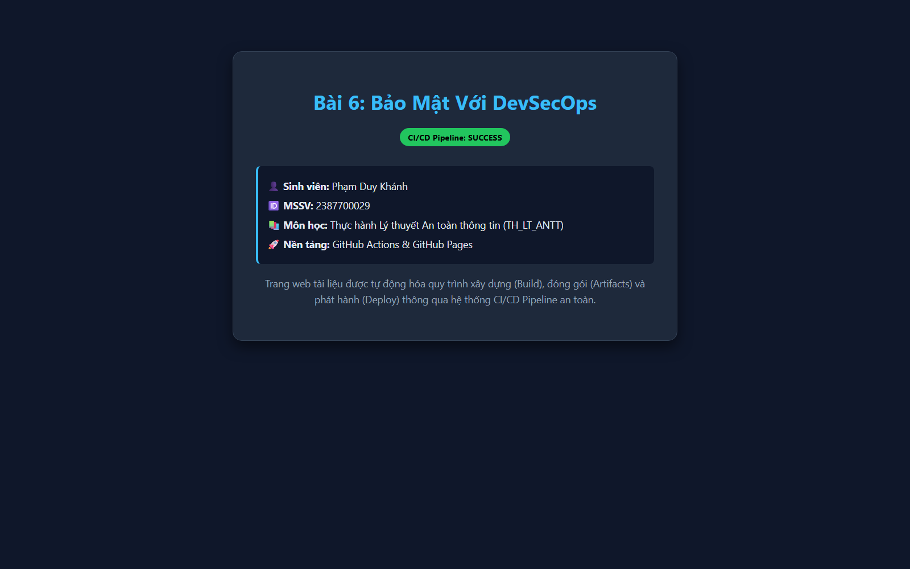

# Báo cáo thực hành Buổi 6: Bảo mật với DevSecOps (GitHub Actions & GitHub Pages)

- **Sinh viên:** Phạm Duy Khánh
- **MSSV:** 2387700029
- **Môn học:** Thực hành Lý thuyết An toàn thông tin (TH_LT_ANTT)
- **Nội dung:** Tích hợp bảo mật trong quy trình CI/CD với GitHub Actions, thiết kế pipeline an toàn, kiểm thử tự động, đóng gói artifacts và tự động hóa xuất bản trang web với GitHub Pages.

---

## 1. Cấu trúc thư mục Buổi 6

```text
buoi6/
├── README.md
├── images/
│   ├── step1_github_actions_runner_permissions.png
│   ├── step2_basic_pipeline_workflow_editor.png
│   ├── step3_workflow_run_in_progress.png
│   ├── step4_workflow_graph_all_jobs_passed.png
│   ├── step5_deploy_job_console_log_details.png
│   ├── step6_docusaurus_config_github_pages.png
│   ├── step7_github_pages_settings_source_actions.png
│   ├── step8_docusaurus_workflow_build_and_deploy.png
│   └── step9_docusaurus_website_live_github_io.png
├── basic-pipeline/
│   └── .github/
│       └── workflows/
│           └── basic-pipeline.yml
├── docusaurus-pipeline/
│   ├── .github/
│   │   └── workflows/
│   │       └── deploy.yml
│   ├── package.json
│   ├── docusaurus.config.js
│   ├── sidebars.js
│   ├── docs/
│   │   └── intro.md
│   └── src/
│       ├── css/
│       │   └── custom.css
│       └── pages/
│           └── index.js
└── security-scanner/
    ├── secret_scanner.py
    ├── iac_security_scanner.py
    └── test_devsecops.py
```

---

## 2. Tổng quan lý thuyết DevSecOps trong CI/CD (GitHub Actions)

### 2.1. Nguyên tắc thiết kế Pipeline an toàn
1. **Kiểm soát quyền truy cập (Access Control & Least Privilege):** Phân quyền tối thiểu cho biến ngữ cảnh `${{ secrets.GITHUB_TOKEN }}` trong GitHub Actions (chỉ cấp quyền `contents: read`, `pages: write`, `id-token: write` khi cần thiết).
2. **Quản lý bí mật (Secrets Management):** Tuyệt đối không lưu trữ khóa bí mật (API Keys, Token, Private Keys, Passwords) trực tiếp trong mã nguồn. Sử dụng GitHub Secrets (`${{ secrets.MY_KEY }}`) và tích hợp công cụ quét rò rỉ tự động (Secret Scanning).
3. **Cổng kiểm soát an ninh tự động (Security Gates):** Thiết lập các chốt chặn bắt buộc (SAST, SCA, IaC Scans). Nếu phát hiện lỗi bảo mật nghiêm trọng (Critical/High), pipeline lập tức dừng thực thi để ngăn mã độc hoặc cấu hình sai sót đi vào nhánh production.
4. **Bảo vệ môi trường Runner:** GitHub-hosted runners hoạt động trong môi trường máy ảo Ubuntu hoàn toàn cô lập, tự động hủy bỏ sau mỗi lần chạy job để tránh lưu vết mã độc.

---

## 3. Phần 1: Xây dựng Pipeline CI/CD cơ bản với GitHub Actions

Pipeline cơ bản gồm 3 giai đoạn và 4 công việc (Jobs):
- **Stage 1 - `build-job`:** Khởi tạo môi trường, in thông tin người dùng kích hoạt (`${{ github.actor }}`) và thông tin nhánh thực thi (`${{ github.ref_name }}`).
- **Stage 2 - `test-job1` & `test-job2`:** Chạy song song 2 bài kiểm thử (sử dụng thuộc tính `needs: build-job`). `test-job2` mô phỏng kiểm thử chuyên sâu với thời gian chạy dài hơn (`sleep 20`).
- **Stage 3 - `deploy-prod`:** Chỉ được kích hoạt khi cả 2 bài kiểm thử thành công (`needs: [test-job1, test-job2]`), triển khai ứng dụng tới môi trường production và lưu vết lịch sử phiên triển khai.

### Cấu hình Workflow Pipeline (`.github/workflows/basic-pipeline.yml`)

```yaml
name: DevSecOps Basic CI/CD Pipeline

on:
  push:
    branches: [ "main", "master" ]
  workflow_dispatch:

jobs:
  build-job:
    name: Build Stage (build-job)
    runs-on: ubuntu-latest
    steps:
      - name: Greet user and environment info
        run: |
          echo "Hello, ${{ github.actor }}!"
          echo "Running on branch: ${{ github.ref_name }}"
          echo "Commit SHA: ${{ github.sha }}"

  test-job1:
    name: Test Stage 1 (test-job1)
    needs: build-job
    runs-on: ubuntu-latest
    steps:
      - name: Run fast security test
        run: echo "This job tests something"

  test-job2:
    name: Test Stage 2 (test-job2)
    needs: build-job
    runs-on: ubuntu-latest
    steps:
      - name: Run simulated longer security test
        run: |
          echo "This job tests something, but takes more time than test-job1."
          echo "After the echo commands complete, it runs the sleep command for 20 seconds"
          echo "which simulates a test that runs 20 seconds longer than test-job1"
          sleep 20

  deploy-prod:
    name: Deploy Stage (deploy-prod)
    needs: [test-job1, test-job2]
    runs-on: ubuntu-latest
    environment: production
    steps:
      - name: Deploy application to production
        run: |
          echo "This job deploys something from the ${{ github.ref_name }} branch."
          echo "Deployment completed successfully!"
```

### Minh chứng thực nghiệm Phần 1

#### Bước 1.1: Kiểm tra quyền thực thi GitHub Actions
Vào mục **Settings > Actions > General**, xác nhận cấu hình **Allow all actions and reusable workflows** để đảm bảo Runner hoạt động bình thường.



#### Bước 1.2: Cấu hình tệp workflow `.github/workflows/basic-pipeline.yml`
Soạn thảo tệp workflow định nghĩa cấu trúc 4 jobs trên GitHub Editor.



#### Bước 1.3: Trạng thái thực thi Workflow (In-Progress)
Vào tab **Actions**, theo dõi workflow `DevSecOps Basic CI/CD Pipeline` được tự động kích hoạt sau khi commit.


#### Bước 1.4: Sơ đồ trực quan (Workflow Graph) hoàn tất thành công
Sơ đồ đồ thị thể hiện tiến trình chạy: `build-job` ➔ 2 nhánh song song `test-job1` & `test-job2` ➔ hội tụ vào `deploy-prod`, toàn bộ 4 job đều đạt dấu tích xanh lá cây (**Success**).



#### Bước 1.5: Chi tiết nhật ký thực thi (Console Log) của `deploy-prod`
Nhật ký terminal in ra rõ ràng dòng chữ: `This job deploys something from the main branch.` cùng thông báo thành công.



---

## 4. Phần 2: Pipeline phức tạp với Docusaurus & Tự động xuất bản GitHub Pages

Quy trình tự động hóa triển khai trang web tài liệu tĩnh qua 2 công đoạn:
1. **Build Job:**
   - Kéo mã nguồn với action `actions/checkout@v4`.
   - Cài đặt Node.js v18 với action `actions/setup-node@v4`.
   - Cài đặt dependencies và thực thi lệnh `npm run build`.
   - Đóng gói toàn bộ thư mục `build/` thành gói Artifacts thông qua action `actions/upload-pages-artifact@v3`.
2. **Deploy Job:**
   - Lấy gói Artifacts vừa được đóng gói an toàn.
   - Sử dụng action chính thức `actions/deploy-pages@v4` để xuất bản website lên GitHub Pages.

### Cấu hình Workflow Deploy (`.github/workflows/deploy.yml`)

```yaml
name: Deploy Docusaurus to GitHub Pages

on:
  push:
    branches: [ "main" ]
  workflow_dispatch:

permissions:
  contents: read
  pages: write
  id-token: write

concurrency:
  group: "pages"
  cancel-in-progress: false

jobs:
  build:
    name: Build site
    runs-on: ubuntu-latest
    steps:
      - name: Checkout repository
        uses: actions/checkout@v4

      - name: Setup Node.js
        uses: actions/setup-node@v4
        with:
          node-version: 18
          cache: npm

      - name: Install dependencies
        run: npm ci || npm install

      - name: Build Docusaurus
        run: npm run build

      - name: Upload artifact
        uses: actions/upload-pages-artifact@v3
        with:
          path: ./build

  deploy:
    name: Deploy to GitHub Pages
    environment:
      name: github-pages
      url: ${{ steps.deployment.outputs.page_url }}
    runs-on: ubuntu-latest
    needs: build
    steps:
      - name: Deploy to GitHub Pages
        id: deployment
        uses: actions/deploy-pages@v4
```

### Minh chứng thực nghiệm Phần 2

#### Bước 2.1: Cấu hình `url` và `baseUrl` trong `docusaurus.config.js`
Thiết lập đường dẫn tĩnh tương thích với URL phát hành của GitHub Pages (`https://khanhphamvn222.github.io`).



#### Bước 2.2: Cấu hình GitHub Pages Source là GitHub Actions
Vào **Settings > Pages**, tại mục **Build and deployment > Source**, chuyển sang tùy chọn **GitHub Actions**.



#### Bước 2.3: Sơ đồ Workflow hoàn chỉnh (Build & Deploy Jobs)
Tab Actions hiển thị tiến trình hoàn thành cả 2 công đoạn: **Build site** (đóng gói Artifacts) và **Deploy to GitHub Pages** (xuất bản thành công).



#### Bước 2.4: Kiểm tra trang web Docusaurus online thực tế trên GitHub Pages
Trang web Docusaurus hoạt động thực tế trên Internet tại địa chỉ tên miền `https://khanhphamvn222.github.io/pipeline-tutorial/`, hiển thị thông tin sinh viên Phạm Duy Khánh - 2387700029.



---

## 5. Phần 3: Bộ công cụ kiểm soát an ninh DevSecOps (Security Scanner)

Nhằm nâng cao tính bảo mật trong toàn bộ chu trình phát triển (DevSecOps), bài thực hành tích hợp bộ công cụ:

1. **`secret_scanner.py` (Secret Scanning):**
   - Quét tìm các dấu vết rò rỉ: AWS Access Keys, GitHub Personal Access Tokens, Private Keys và mật khẩu hardcoded.
   - Cơ chế che giấu dữ liệu nhạy cảm (Data Masking) khi in log kiểm tra.
   - Cổng an ninh (*Security Gate*): Tự động phát hiện và chặn các commit chứa rủi ro bảo mật mức HIGH hoặc CRITICAL.

2. **`iac_security_scanner.py` (IaC Configuration Scanner):**
   - Phân tích cú pháp Dockerfile và file cấu hình CI/CD YAML.
   - Phát hiện các cấu hình vi phạm an ninh: Chạy container dưới quyền `root`, sử dụng `latest` tag không định danh phiên bản, hoặc thực thi trực tiếp script từ xa (`curl | bash`).

3. **`test_devsecops.py` (Automated Security Gate Unit Tests):**
   - Kiểm thử đơn vị tự động 5/5 kịch bản bảo mật: phát hiện hardcoded password, phát hiện token AWS/GitHub, chặn Security Gate và phát hiện rủi ro IaC.

---

## 6. Đánh giá và Kết luận

- Hoàn thành đầy đủ các mục tiêu thực hành của **Bài 6: Bảo mật với DevSecOps** trên nền tảng **GitHub Actions & GitHub Pages**.
- Nắm vững cú pháp YAML của GitHub Actions, cách thức tổ chức các Stage, Job, Dependencies (`needs`), Artifacts và biến môi trường.
- Hiểu rõ cơ chế của các chốt kiểm soát an ninh tự động (Security Gates) và tự động hóa xuất bản sản phẩm phần mềm an toàn lên môi trường production.
